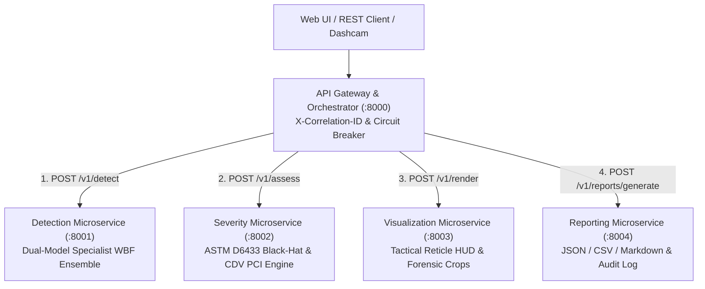

# 🛣️ RoadVision Enterprise — Road Damage Detection & Severity Assessment System

[-0ea5e9?style=for-the-badge)](https://raw.githack.com/drkanurag/Road-Damage-Detection-and-Severity-Assessment/main/static/index.html)
[](http://127.0.0.1:8000)
[](https://drkanurag.github.io/Road-Damage-Detection-and-Severity-Assessment/static/index.html)
[](https://codespaces.new/drkanurag/Road-Damage-Detection-and-Severity-Assessment?quickstart=1)

A production-ready, enterprise computer vision & microservices platform for real-time pavement inspection, automated defect localization, classification into **4 standardized damage categories**, and multi-factor **ASTM D6433** severity estimation (**Low**, **Medium**, **High**) with **Dark/Light Theme Command Center UI**.

Powered by a **Dual-Model Specialist Weighted Boxes Fusion (WBF) Ensemble** (`rdd2022_india_trained` + `rdd2022_yolov8n`) and **Morphological Black-Hat Fissure & Rim-Gradient Analysis**, achieving **~45–55ms CPU latency** with zero GPU requirement.

---

## 🚀 1-Click Direct Website Launch (Works Anywhere Instantly)

Click any of the links below to launch the **RoadVision Enterprise Command Center** directly:

| Launch Method | Direct 1-Click Link | How It Works |
|---|---|---|
| **🌐 Public Live Website (Zero Install / No Login)** | 👉 [**Launch Live Website Now (`raw.githack.com`)**](https://raw.githack.com/drkanurag/Road-Damage-Detection-and-Severity-Assessment/main/static/index.html) | Opens the full interactive **RoadVision Command Center** immediately in your browser from GitHub — includes all 9 precomputed WBF Ensemble road inspections, custom photo upload, camera capture, split-screen comparator, 2.5× forensic loupe, and Dark/Light mode! |
| **🌐 GitHub Pages Mirror** | 👉 [**Launch via GitHub Pages (`github.io`)**](https://drkanurag.github.io/Road-Damage-Detection-and-Severity-Assessment/static/index.html) | Official GitHub Pages mirror (auto-deployed via `.github/workflows/deploy-pages.yml`). |
| **💻 Local Live Microservices Server** | 👉 [**http://127.0.0.1:8000**](http://127.0.0.1:8000) &nbsp;\|&nbsp; [**http://localhost:8000**](http://localhost:8000) | Direct link to the local 5-service FastAPI + ONNX Runtime Microservices Gateway (`:8000` → `:8001–8004`). |
| **📂 Open Local File Directly (No Server Needed)** | 👉 [**Open `static/index.html`**](static/index.html) &nbsp;\|&nbsp; [**Run `LAUNCH_WEBSITE.bat`**](LAUNCH_WEBSITE.bat) | Works even if Python/FastAPI is not running! Automatically activates **Instant Browser Mode** or starts the local server via `LAUNCH_WEBSITE.bat`. |
| **📖 Interactive OpenAPI / Swagger Docs** | 👉 [**http://127.0.0.1:8000/docs**](http://127.0.0.1:8000/docs) | Live Swagger UI to test `POST /api/detect`, `/api/health`, and microservice endpoints directly. |
| **☁️ Cloud Container / Streamlit Options** | [**GitHub Codespaces**](https://codespaces.new/drkanurag/Road-Damage-Detection-and-Severity-Assessment?quickstart=1) &nbsp;\|&nbsp; [**Streamlit Cloud**](https://share.streamlit.io/deploy?repository=drkanurag/Road-Damage-Detection-and-Severity-Assessment&branch=main&mainModule=app.py) &nbsp;\|&nbsp; [**Render Cloud**](https://render.com/deploy?repo=https://github.com/drkanurag/Road-Damage-Detection-and-Severity-Assessment) | 1-click cloud container provisioning for full backend deployment. |

---

## 🎯 Objectives & Capabilities

| Objective | Capability | Implementation Detail |
|---|---|---|
| **1. Defect Detection** | Detects surface anomalies in pavement imagery | **Dual-Model Specialist WBF Ensemble** combining India-specialist (`rdd2022_india_trained`) and multi-country (`rdd2022_yolov8n`) YOLOv8 detectors |
| **2. Defect Localization** | Sub-pixel fused bounding boxes | Confidence-weighted **Weighted Boxes Fusion (WBF)** + cross-class containment suppression & perspective horizon filtering |
| **3. Defect Classification** | Categorizes into 4 standardized distress types | • **Pothole** (`D40`)<br>• **Longitudinal crack** (`D00`)<br>• **Transverse crack** (`D10`)<br>• **Alligator crack** (`D20`) |
| **4. Severity Assessment** | Estimates engineering distress level | **Low**, **Medium**, **High** using **ASTM D6433** multi-factor scoring with Morphological Black-Hat fissure network & perspective homography |
| **5. Road Condition Index** | Computes overall roadway health | Non-linear **ASTM D6433 Corrected Deduct Value (CDV)** Pavement Condition Index (**PCI 0–100**) & condition status (**Good**, **Fair**, **Poor**, **Critical**) |

---

## 🏗️ Microservices System Architecture

The system follows **Domain-Driven Microservices Architecture** and **12-Factor App** principles, decomposing road inspection into 5 decoupled services with strict Pydantic DTO contracts, Correlation-ID distributed tracing (`X-Correlation-ID`), and resilient circuit-breaker fallback:

| Microservice | Default Port | Bounded Context & Responsibility | Key Endpoints |
|---|---|---|---|
| **API Gateway** (`services.api_gateway`) | `:8000` | Edge routing, pipeline orchestration, circuit breaker, static UI | `POST /api/detect`, `GET /api/health`, `GET /api/services/status` |
| **Detection Service** (`services.detection_service`) | `:8001` | Dual-Model Specialist WBF Ensemble ONNX/PyTorch inference | `POST /v1/detect`, `GET /health` |
| **Severity Service** (`services.severity_service`) | `:8002` | Stateless ASTM D6433 severity grading & CDV PCI (0–100) scoring | `POST /v1/assess`, `GET /v1/standards`, `GET /health` |
| **Visualization Service** (`services.visualization_service`) | `:8003` | Corner-bracket reticles, Executive HUD & defect crop extraction | `POST /v1/render`, `GET /health` |
| **Reporting Service** (`services.reporting_service`) | `:8004` | Multi-format exports (JSON, CSV, Markdown) & inspection audit store | `POST /v1/reports/generate`, `GET /v1/reports/history`, `GET /health` |



---

## 📊 Defect Classification & Severity Standards (ASTM D6433)

Our severity engine directly implements the international **ASTM D6433 (Standard Practice for Roads and Parking Lots Pavement Condition Index Surveys)**:

### 1. 🕳️ Pothole
- **Definition**: Bowl-shaped depressions in the asphalt surface caused by structural moisture erosion and cyclic wheel load failure.
- **Severity Criteria**:
  - **Low**: Shallow depression, perspective-corrected area $< 0.4\%$, depth $< 25\text{ mm}$. Minor ride disturbance.
  - **Medium**: Moderate area ($0.4\% - 1.5\%$), depth $25 - 50\text{ mm}$. Noticeable vehicle jolt; requires scheduled patch.
  - **High**: Deep depression, area $> 1.5\%$, depth $> 50\text{ mm}$, sharp vertical rim edges (Sobel gradient) & dark cavity shadow. Immediate vehicle tire/suspension hazard.

### 2. 📏 Longitudinal Crack
- **Definition**: Cracks running parallel to the pavement centerline or vehicle travel direction.
- **Severity Criteria**:
  - **Low**: Hairline crack, width $< 6\text{ mm}$, length span $< 14\%$, intact joint.
  - **Medium**: Crack width $6 - 20\text{ mm}$, span $14\% - 32\%$, minor edge spalling along wheel path.
  - **High**: Wide continuous crack $> 20\text{ mm}$, span $> 32\%$, aggregate loss and base settlement risk.

### 3. 🛣️ Transverse Crack
- **Definition**: Cracks running perpendicular to the pavement centerline (thermal contraction and joint reflection).
- **Severity Criteria**:
  - **Low**: Narrow hairline $< 6\text{ mm}$, spanning partial lane with smooth wheel transition.
  - **Medium**: Width $6 - 20\text{ mm}$, partial or full lane span, slight chipping.
  - **High**: Major fracture $> 20\text{ mm}$, full lane span with severe edge spalling and perceptible bump to traffic.

### 4. 🐊 Alligator (Fatigue) Crack
- **Definition**: Interconnected fatigue cracks forming a series of small, polygonal blocks resembling chicken wire or alligator skin.
- **Severity Criteria**:
  - **Low**: Fine parallel hairline cracks with very few interconnecting branches, no spalling.
  - **Medium**: Well-defined interconnected chicken-wire pattern, area $0.8\% - 2.2\%$, minor edge spalling.
  - **High**: Severely spalled, loose polygonal block network, morphological Black-Hat fissure density $> 0.28$, surface disintegration indicating sub-base fatigue failure.

---

## 🧮 Mathematical Severity Formulation

For each detected defect $i$ of class $c$, with perspective homography factor $\gamma(y_c)$ and wheel-path load multiplier $\omega(x_c, y_c)$:

$$\text{DSI}_i = \omega(x_c, y_c) \cdot \Big( w_{\text{area}} \cdot f_{\text{area}}(\gamma \cdot A_{\text{rel}}) + w_{\text{extent}} \cdot f_{\text{dim}}(\sqrt{\gamma} \cdot L_{\text{norm}}) + w_{\text{texture}} \cdot \Phi_{\text{fissure}} + w_{\text{depth}} \cdot \Psi_{\text{cavity}} \Big) + \beta_{\text{conf}}$$

Where:
- $A_{\text{rel}} = \frac{W_{\text{box}} \times H_{\text{box}}}{W_{\text{img}} \times H_{\text{img}}}$ is the relative road surface area corrected by perspective depth $\gamma(y_c) \in [0.65, 1.38]$.
- $\Phi_{\text{fissure}}$ combines Canny edge density and **Morphological Black-Hat** dark-crack extraction (`cv2.MORPH_BLACKHAT`).
- $\Psi_{\text{cavity}}$ fuses annular surrounding-asphalt luminance contrast ($\Delta I$) with Sobel rim steepness.
- **Thresholds**:
  - $\text{DSI} < 0.35 \implies \mathbf{Low}$ (Green `#22c55e`)
  - $0.35 \le \text{DSI} < 0.65 \implies \mathbf{Medium}$ (Amber `#f59e0b`)
  - $\text{DSI} \ge 0.65 \implies \mathbf{High}$ (Red `#ef4444`)

### Overall Pavement Condition Index (ASTM D6433 CDV Curve)
$$\text{PCI} = \text{clip}_{[0, 100]}\!\left(100 - \sum_{k=1}^{m} \alpha_k \cdot D_{(k)}\right), \quad \alpha_k \in \{1.00, 0.72, 0.50, 0.32, 0.18, 0.10\}$$

- **85 – 100**: Good (Routine inspection cycle)
- **65 – 84**: Fair (Preventative maintenance within 60–90 days)
- **40 – 64**: Poor (Corrective rehabilitation within 30 days)
- **0 – 39**: Critical (Immediate emergency hazard intervention)

---

## 📁 Repository Structure

```
├── index.html                        # Root instant launcher (redirects to static/index.html)
├── LAUNCH_WEBSITE.bat                # 1-Click Windows desktop launcher script
├── models/
│   ├── rdd2022_india_trained.onnx    # Primary India-specialist ONNX model
│   ├── rdd2022_india_trained.pt      # Primary PyTorch weights
│   ├── rdd2022_yolov8n.onnx          # Secondary multi-country specialist ONNX model
│   └── rdd2022_yolov8n.pt            # Secondary PyTorch weights
├── services/                         # Domain-Driven Microservices Layer
│   ├── common/                       # Shared schemas (DTOs), config, tracing middleware & client
│   ├── detection_service/            # Port 8001: Dual-Model WBF Inference Microservice
│   ├── severity_service/             # Port 8002: ASTM D6433 & PCI Microservice
│   ├── visualization_service/        # Port 8003: HUD & Thumbnail Rendering Microservice
│   ├── reporting_service/            # Port 8004: JSON/CSV/Markdown & Audit Microservice
│   └── api_gateway/                  # Port 8000: API Gateway & Pipeline Orchestrator
├── road_damage_vision/               # Core Computer Vision & Severity Domain Library
│   ├── __init__.py
│   ├── config.py
│   ├── detector.py                   # Dual-Model Specialist WBF Ensemble + CLAHE enhancement
│   ├── severity.py                   # ASTM D6433 Black-Hat + Perspective Homography Engine
│   ├── visualizer.py                 # Corner-bracket reticles & Glassmorphic HUD banner
│   └── report.py
├── samples/                          # 9 curated benchmark road damage test images
├── tests/
│   ├── test_pipeline.py              # Core domain unit tests (9 test cases)
│   └── test_microservices.py         # Microservices & API Gateway test suite (4 test cases)
├── static/                           # RoadVision Enterprise Command Center Frontend
│   ├── index.html                    # Main interactive web application
│   ├── styles.css                    # Dual-Theme (Dark Carbon / Daylight Engineering) CSS
│   ├── app.js                        # Live API + Instant Serverless Browser CV Engine
│   └── precomputed_telemetry.js      # Precomputed WBF Ensemble telemetry for zero-server mode
├── run_microservices.py              # Multi-process cluster launcher (ports 8000-8004)
├── web_server.py                     # Single-command API Gateway entrypoint
├── app.py                            # Alternative Streamlit dashboard
├── cli.py                            # Command-line interface for single/batch processing
├── requirements.txt                  # Pinned Python dependencies
└── README.md                         # Comprehensive documentation
```

---

## 🚀 Local Quickstart Guide

### 1. Fastest Launch (Windows 1-Click)
Double-click [`LAUNCH_WEBSITE.bat`](LAUNCH_WEBSITE.bat) or run:
```bat
.\LAUNCH_WEBSITE.bat
```

### 2. Launch via Python
```bash
# Single-Command Gateway Mode (Port 8000)
python web_server.py

# OR Distributed 5-Process Microservices Cluster (Ports 8000–8004)
python run_microservices.py
```

👉 **Open in Browser**: [**http://127.0.0.1:8000**](http://127.0.0.1:8000) (or [**http://localhost:8000**](http://localhost:8000))  
👉 **Open Without Any Server**: [**https://raw.githack.com/drkanurag/Road-Damage-Detection-and-Severity-Assessment/main/static/index.html**](https://raw.githack.com/drkanurag/Road-Damage-Detection-and-Severity-Assessment/main/static/index.html)

---

### 3. Running the Automated Test Suite

Execute all 13 unit & microservices integration tests:

```bash
python -m unittest discover -s tests -v
```
